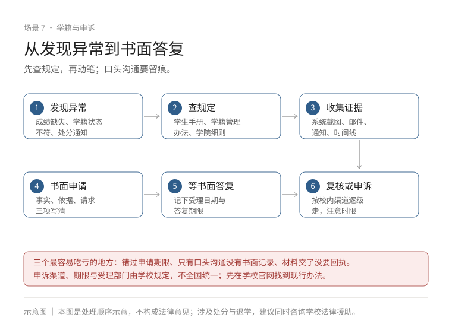

# Playbook：学籍异常与学校事务申诉

遇到学籍问题，最容易犯的错是**先找人说情，而不是先看制度**。这篇给一个固定顺序：**确认决定 → 找依据 → 核时限 → 备证据 → 走书面流程 → 留记录**。

各校细则不同，具体条款以本校学生手册、学籍管理规定与学院通知为准；涉及处分申诉的法定时限来自《普通高等学校学生管理规定》（教育部令第 41 号）。

## 一、常见问题与对应的决定主体

| 问题 | 谁作出决定 | 先看什么文件 |
| --- | --- | --- |
| 挂科、补考、重修 | 学院/教务处 | 考核与成绩管理办法 |
| 学分不足、学业预警 | 学院 | 学业预警办法、培养方案 |
| 延期毕业/结业 | 学院初审、教务处审定 | 学籍管理规定、毕业审核办法 |
| 休学、复学 | 学院、教务处 | 学籍管理规定（休复学条款） |
| 退学（本人申请或学校处理） | 学院、校长办公会 | 学籍管理规定（退学条款） |
| 转专业 | 学院、教务处 | 转专业实施办法 |
| 成绩认定/复核 | 开课学院、教务处 | 成绩管理办法 |
| 奖学金/评优争议 | 学院评审小组、学生工作部门 | 评审办法与公示规则 |
| 学生处分 | 学院/学校 | 学生违纪处分规定 |
| 毕业资格/学位 | 学院、教务处、学位评定委员会 | 毕业审核与学位授予细则 |

**第一步永远是：确认这件事是谁作出的、依据哪一条。** 口头通知不算决定，书面文件才算。

## 二、通用八步

1. **确认发生了什么**：哪门课、哪学期、哪个决定、依据哪条制度；
2. **找现行制度**：学生手册、学籍管理规定、学院实施细则（注意版本与生效日期）；
3. **核条件与时限**：申请条件、材料、截止时间、逾期后果；
4. **整理证据**：通知、成绩单、作业/试卷、邮件与聊天记录、医疗证明；
5. **找负责部门**：先问具体经办人，问清"要什么材料、什么时候给答复"；
6. **提交书面申请**：写清事实、依据、请求，留副本与提交记录；
7. **保存受理信息**：受理编号、经办人、答复期限；
8. **按正式回复决定下一步**：不服再走复核/申诉，不靠传言判断。



## 三、五类情况怎么做

### 1. 成绩争议 / 复核

- 先看学校**成绩复核**办法：多数只核"登分、合分、漏批"，不重新评阅主观题；
- 在公布成绩后的规定期限内提交书面复核申请（各校不同，通常几天到两周）；
- 附上试卷、作业、评分标准等证据；
- 复核结果书面保存。对复核结论仍有异议，走学院教学委员会或教务处申诉渠道。

### 2. 学业预警 / 学分不足

- 预警不是处分，但会触发限制（选课、评优、毕业）；
- 先算清**还差多少学分、哪几门、能不能补**：培养方案 + 已修成绩单；
- 与辅导员/教务谈一个**补救计划**（重修、替代课程、延长学习年限），书面记录；
- 涉及延期毕业的，问清结业与毕业的差别、补考补作的最晚时间。

### 3. 休学与复学

- **休学**：本人申请或学校认为应当休学，经批准后办理离校；休学期间保留学籍，但不享受在校生待遇（《学生管理规定》第 25、28 条）；
- **复学**：休学期满前按学校期限提出申请，经复查合格方可复学（第 29 条）；因病休学的通常要交康复证明；
- 注意**最长学习年限**（含休学），超过可能触发退学处理（第 30 条）；
- 参军入伍可保留学籍至退役后 2 年（第 27 条）。

### 4. 毕业资格 / 学位问题

- 先分清**结业与毕业**：修完计划但未达毕业要求，学校可准予结业并发结业证书；结业后能否补考/补作论文、是否换发毕业证与学位证，由学校规定（第 33 条）；
- 学分、论文、体测、处分、学术诚信，任何一项都可能卡住；
- 毕业审核有公示期，**公示期内提异议**比事后补救有效；
- 学位授予由学位评定委员会决定，学院初审不等于最终结果。

### 5. 处分争议

法定流程与时限（《学生管理规定》第 59–62 条）：

```
收到处理/处分决定书
  → 10 日内：向学校学生申诉处理委员会提交书面申诉
  → 15 日内：委员会作出复查结论（复杂可延 15 日）
  → 不服复查：15 日内向学校所在地省级教育行政部门书面申诉
  → 省级部门 30 个工作日内处理并作出决定
```

**关键点**：

- 申诉针对的是**事实、依据、程序、定性、处分是否适当**，不是"求情"；
- 逾期未申诉视为放弃（第 64 条第一款），时限从**送达之日**起算，签收记录要留好；
- **未告知申诉期限的例外**：处分决定书未告知申诉期限的，申诉期限自学生**知道或者应当知道**处理或处分决定之日起计算，**最长不得超过 6 个月**（第 64 条第二款）。这与"处分决定书应当载明申诉途径和期限"（第 53 条）是配套的两条：学校没写，不等于学生没有救济机会，但最长只到 6 个月；
- 申诉期间可申请暂缓执行，是否准许由学校决定；
- 涉及开除学籍、学位撤销等重大决定，建议同时咨询学校法律事务机构或专业律师。

**这组时限只管"处理或处分申诉"**：第 60–62 条的 10 日 / 15 日 / 30 个工作日，适用于对学校处理或处分决定不服的正式申诉程序。**成绩复核、学分认定、评奖争议、宿舍调整等普通校园事务，不套用这组时限**，按学校教务、学院或相关部门的办事规定办理；这些规定各校差异很大，先查本校文件。

## 四、校内沟通、复核、申诉、外部救济：别混为一谈

| 层级 | 是什么 | 适用 |
| --- | --- | --- |
| 沟通 | 找经办人问清情况、补材料 | 信息不清、材料缺漏 |
| 复核 | 对成绩、评审结果等**具体事项**重新核对 | 成绩登分、评审计分 |
| 校内申诉 | 对**处理或处分决定**不服，向学生申诉处理委员会提出 | 处分、退学处理等 |
| 外部救济 | 向省级教育行政部门申诉；涉及人身/财产权益可依法提起诉讼 | 校内申诉后仍不服 |

**不要宣称所有学校决定都能走同一种程序**：成绩复核走教务渠道，处分走申诉委员会，二者不是一回事；能否起诉、起诉什么，取决于争议性质与法律规定，必要时找律师。

## 五、证据与沟通

### 证据清单

- [ ] 决定书/通知原件或截图（含日期、文号、盖章）
- [ ] 成绩单、试卷、作业、评分标准
- [ ] 培养方案与课程大纲
- [ ] 邮件、聊天记录、通话记录
- [ ] 医疗证明、家庭情况证明（如适用）
- [ ] 你提交过的申请与学校的签收/回复
- [ ] 证人信息（同学、任课老师）

### 和学校沟通时先说清四件事

1. 我是谁（学院、专业、学号）；
2. 我遇到的具体问题与时间；
3. 我依据哪条制度提出什么请求；
4. 我希望在什么时间前得到答复。

### 书面申请的结构（可直接套用）

```
标题：关于××的申诉/复核申请
一、基本情况：姓名、学号、学院、专业、联系方式
二、事实经过：时间、地点、经过、涉及人员（按时间顺序）
三、依据：学校制度条款/《学生管理规定》条款
四、请求：撤销/变更/重新核定（写具体）
五、附件清单：决定书、成绩单、聊天记录等
落款：姓名、日期
```

**提交方式**：当面递交要签收；线上提交要截图保存"提交成功"页面；邮寄用可查询的快递。

## 六、失败之后怎么办

1. 拿到**书面**复查结论，确认理由与依据；
2. 判断还有没有下一层渠道（省级教育行政部门、学校法律事务机构）；
3. 复核时限：省级申诉通常要求在收到复查决定后 15 日内提出；
4. 涉及重大权益（退学、开除、学位），尽快咨询律师，评估诉讼可行性；
5. 同步准备**备选方案**：转学、复读、就业、间隔一年，别把所有时间押在一条通道上。

:::resources campus-issue-evidence, written-request-template, appeal-submit-checklist
:::

## 相关

- [休学、复学与退学](../../book/00-从这里开始.md#judge-worth-it)
- [挂科与重修](../../book/02-在学校里先把基础打好.md#gpa-matters)
- [毕业去向与离校手续总清单](毕业去向与离校手续总清单.md)
- [遇到纠纷找谁](../rights/遇到纠纷找谁.md)
- [学籍问题记录表](../tools/学籍问题记录表.md)

## 来源与更新
最后核实：2026-10-17

- 教育部：《普通高等学校学生管理规定》（教育部令第 41 号）全文，第 25–33 条（休学复学、退学、毕业结业）、第 53 条（处分决定书应载明申诉途径和期限）、第 59–64 条（学生申诉，含第 64 条未告知期限时最长 6 个月）。https://www.moe.gov.cn/jyb_xxgk/xxgk/zhengce/guizhang/202112/t20211206_585064.html （Official）
- 各高校：学生手册、学籍管理规定、成绩复核与处分办法（逐校核实，条款与时限可能更细）。 （Official）
- 流程与文书结构为本项目整理的操作方法，不构成法律意见。 （Experience-based）
