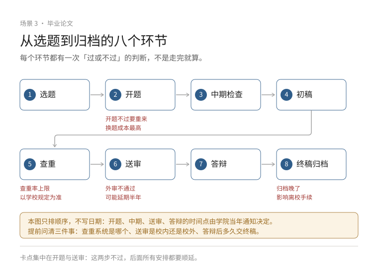

# Playbook：本科毕业论文与毕业设计

本科论文与研究生论文的差别不在篇幅，而在**时间与资源**：你只有一学期到一学年，设备、数据、指导时间都有限。所以第一原则是：**把题目做到"能完成"，而不是"听起来很大"。**

流程、表格名称、查重系统与答辩形式**各校不同**，一律以本校教务处、学院与指导老师的当年通知为准。

## 一、选题：先判断"能不能做完"

### 四类课题，做法完全不同

| 类型 | 典型形式 | 主要风险 | 关键产出 |
| --- | --- | --- | --- |
| 理论研究 | 文献综述、模型分析、政策研究 | 题目空、结论泛 | 清晰的问题与论证链 |
| 实验研究 | 材料、化学、生物、物理实验 | 设备排队、试剂周期、重复失败 | 可重复的实验记录与数据 |
| 工程项目 | 系统开发、硬件设计、工艺改进 | 需求膨胀、联调不通 | 能跑的原型 + 测试记录 |
| 设计类 | 毕业设计、方案设计、作品集 | 只交图不讲依据 | 方案 + 依据 + 迭代记录 |

### 选题自检五问

1. **时间**：按你每周能投入的小时数，这件事能在截止前做完吗？把时间砍掉 30% 再算一遍；
2. **资源**：设备、试剂、数据、软件、算力，谁提供？排队要多久？拿不到时的替代方案是什么？
3. **能力**：核心步骤你会吗？不会的部分，学它要多久？有没有人能问？
4. **指导**：导师的方向与你的题目匹配吗？他多久能给你一次反馈？
5. **验收**：什么算"做完了"？导师说的"做出点东西"要落成具体指标（跑通、误差范围、样本量、可演示）。

五问里有两问答不上来，就把题目缩小一半再谈。

### 和导师第一次谈，带三样东西

- 一页纸的**题目草案**：问题、方法、预期产出、时间表；
- **两个备选方案**：一个保守（一定能完成），一个进取（有亮点但风险高）；
- 你**已经查过的三篇文献**（证明你不是空手来要题目）。

谈完记下：导师认可的边界、他要求的产出形式、下次汇报时间。

### 什么时候该调整选题

- 连续两周核心步骤没有进展，且原因不是"不够努力"（设备、数据、权限）；
- 中期检查前发现关键数据拿不到，且没有替代来源；
- 题目与导师方向偏离过大，反馈一直对不上。

调整要**带着方案去谈**：A 方案砍掉哪部分、B 方案换什么数据、各自要多少时间。不要只说"做不出来"。

## 二、从选题到答辩：十二步

```
1 选题 → 2 文献检索 → 3 任务书/开题 → 4 方案设计
→ 5 实验/开发/设计 → 6 中期检查 → 7 数据与结果整理
→ 8 撰写 → 9 导师审核 → 10 查重与规范检查
→ 11 答辩 → 12 修改与提交
```

| 步骤 | 要交什么 | 常见卡点 |
| --- | --- | --- |
| 选题 | 题目、方向说明 | 题目过大，一人做不完 |
| 文献 | 20–40 篇的清单与笔记 | 只读摘要，写的时候不会用 |
| 开题 | 开题报告/任务书 | 研究问题写成"介绍某某" |
| 方案 | 技术路线、时间表 | 没有备选方案 |
| 实施 | 实验记录、代码、设计稿 | 不记录过程，最后无法复现 |
| 中期 | 进度报告 | 前期拖延，中期才发现 |
| 整理 | 数据表、图表 | 数据口径不一致 |
| 撰写 | 初稿 | 写成说明书，没有论证 |
| 审核 | 导师修改意见 | 拖到最后一周才给导师看 |
| 查重 | 检测报告 | 引用格式不规范导致重复率高 |
| 答辩 | PPT、讲稿 | 超时、念稿 |
| 提交 | 最终版与附件 | 格式、签字、归档不合格 |

**每个学校的前置条件不同**（开题不通过能否进下一环节、中期不过怎么办），在开题前问清学院的流程文件。



## 三、做不出来怎么办：七种故障的处理顺序

前提：**不伪造数据、不编造结果、不代写**。以下都是"在真实前提下把损失降到最小"的做法。

| 故障 | 第一步 | 退路 |
| --- | --- | --- |
| 实验一直失败 | 记录失败条件，找同组/师兄复现一次，判断是操作、材料还是设备 | 改为"失败条件分析"型论文，把负结果讲清楚 |
| 数据不足 | 列出还缺什么、谁能提供、最晚什么时候能给 | 缩小结论范围，改用公开数据集/仿真补充 |
| 系统功能做不完 | 砍功能，保核心链路，把砍掉的部分写成"后续工作" | 改为原型 + 设计论证 |
| 代码无法复现 | 固定环境（版本、随机种子），保存运行日志 | 在论文中如实说明复现条件与限制 |
| 进度落后 | 重排倒计时表，先保"能答辩的最小闭环" | 申请延期（先问清学院政策与后果） |
| 导师不回 | 换渠道（邮件+办公室+同组师兄），书面写明需要什么反馈 | 找共同指导老师或学院教务协调 |
| 选题不可行 | 带两套替代方案找导师，越早越好 | 换题/缩题，保留已完成的部分作为一章 |

**如果临近答辩仍缺关键结果**：先问学院是否允许"阶段性成果 + 局限性分析"答辩，再决定是延期还是调整范围。**不要用编数据换按期毕业**——学位法实施后，学术不端可被撤销学位，代价远大于延期。

## 四、规范与学术诚信

### 引用与文献管理

- 用文献管理工具（Zotero、EndNote 等）建库，边读边记**出处、页码、原文**；
- 引用要能追到原始文献，不引"某文章说某研究表明"的二传；
- 直接引用加引号并标页码，转述也要标注。

### 数据、记录与代码

- **原始数据不覆盖**：每次处理另存一份，保留处理脚本；
- **实验记录当天写**：日期、条件、现象、异常，别靠回忆；
- **代码进版本库**：至少保留能跑通的那一版，README 写清运行方式。

这三样在答辩被追问"这个结果怎么来的"时，是唯一能救你的东西。

### 查重怎么看

- 查重系统由学校指定，**不同系统结果不同**，不要拿外面的结果当最终结论；
- 重复率不是唯一标准：**连续重复、结构照搬、改写但观点照抄**都可能被认定问题；
- 引用格式不规范会推高重复率，先按学校模板改格式再查；
- 学校一般有 1–2 次免费检测机会，别浪费在没写完的稿子上。

### 明确不能做的事

- 抄袭、拼凑、代写、买卖论文；
- 伪造或篡改数据、选择性删除不利结果；
- 不当署名（没参与的人署名、参与的人不署名）；
- 把同一成果重复发表而不说明。

### AI 工具：先查校规，再决定怎么用

各校规定不同，**没有全国统一标准**。可先按这个边界自查：

- 可以用：查文献线索、语言润色、格式整理、代码调试、思路讨论；
- 必须自己完成并能解释：研究设计、数据分析、结论、答辩陈述；
- 无论学校是否允许，**提交的内容你要能解释每一处**——答辩追问两层就露馅；
- 如果学校要求声明 AI 使用情况，按要求写清用途与范围。

## 五、答辩：讲清四件事，答好三类问题

### PPT 结构（10–15 分钟版）

1. 问题与背景（1–2 页）：为什么值得做；
2. 方法与方案（3–4 页）：你怎么做的，关键选择是什么；
3. 结果（3–4 页）：最重要的 2–3 个结果，配图；
4. 讨论与局限（1–2 页）：结果说明什么、不说明什么；
5. 结论与后续（1 页）。

**每页只讲一件事**，图比字好，字号不小于 24。

### 时间控制

- 按 1 页 1 分钟准备，留 20% 缓冲；
- 提前完整讲两遍并计时，第三遍讲给一个不懂你题目的同学听；
- 超时是大忌：讲到第 8 分钟还没进结果，直接跳到结果。

### 三类问题的答法

| 问题类型 | 例 | 答法 |
| --- | --- | --- |
| 方法与依据 | "为什么用这个方法？" | 依据 + 替代方案 + 为什么没选它 |
| 结果与解释 | "这个提升是真实的吗？" | 数据 + 对照 + 误差范围 |
| 边界与局限 | "这个方法在什么情况下失效？" | 明确说出边界，不硬撑 |

**不会的问题**：承认"这部分我没有做/没有验证"，接着说"如果继续做，我会先……"。**不要编**——评委通常比你想的更懂这个题。

### 被质疑时

- 先复述对方的问题，确认理解一致；
- 用数据回答，不用情绪；
- 如果是评委指出错误，记下来，答辩后核对；当场能改的口头承认。

### 答辩后

当天整理**修改清单**：谁提的、改什么、改到哪一页/哪一节。按学院要求在规定时间内提交修改说明与最终版。

## 六、阶段检查清单

**开题前**

- [ ] 题目能用一句话说清"研究什么问题、怎么做、产出什么"
- [ ] 时间表按周排到答辩，且留了 20% 缓冲
- [ ] 设备/数据/软件有着落，或已有替代方案
- [ ] 与导师确认了验收标准与汇报频率

**中期**

- [ ] 核心步骤至少跑通一次（哪怕结果不理想）
- [ ] 实验记录/代码/设计稿可追溯
- [ ] 进度落后时有明确的缩题方案

**写作前**

- [ ] 图表齐了，每张图能独立看懂
- [ ] 数据口径统一，单位与误差写清
- [ ] 参考文献格式按学校模板

**提交前**

- [ ] 导师看过终稿并同意提交
- [ ] 查重按学校要求完成，重复部分已处理
- [ ] 格式、页眉页脚、目录、签字页符合模板
- [ ] 附件（数据、代码、设计源文件）按要求归档
- [ ] 答辩 PPT 与讲稿已计时演练

:::resources thesis-final-checklist, thesis-schedule, weekly-research-log, defense-outline
:::

## 相关

- [第一次写论文](第一次写论文.md) —— 研究生阶段的论文写作与投稿，和本科毕设不是一回事
- [科研入门时间线](../timelines/科研入门时间线.md)
- [实验记录模板](../tools/实验记录模板.md)
- [Failure 日志](../tools/Failure日志.md)
- [本科毕设进度表](../tools/毕设进度表.md)
- [论文精读表](../tools/论文精读表.md)
- [做项目、打比赛、进实验室](../../book/03-做项目、打比赛、进实验室.md)

## 来源与更新
最后核实：2026-10-17

- 教育部：《本科毕业论文（设计）抽检办法（试行）》（教督〔2020〕5 号）全文，抽检每年一次、比例原则上不低于 2%。https://www.gov.cn/zhengce/zhengceku/2021-01/07/content_5577651.htm （Official）
- 《中华人民共和国学位法》全文（2024 年 4 月 26 日通过，2025 年 1 月 1 日施行）：学位授予、学术复核与撤销学位的规定。http://www.npc.gov.cn/npc/c2/c30834/202404/t20240426_436840.html （Official）
- 各高校教务处与学院：毕业论文（设计）管理办法、开题/中期/答辩流程、查重与格式规范（逐校核实）。 （Official）
- 流程、故障处理与答辩方法为本项目整理的操作经验，不替代学校规定与导师意见。 （Experience-based）
